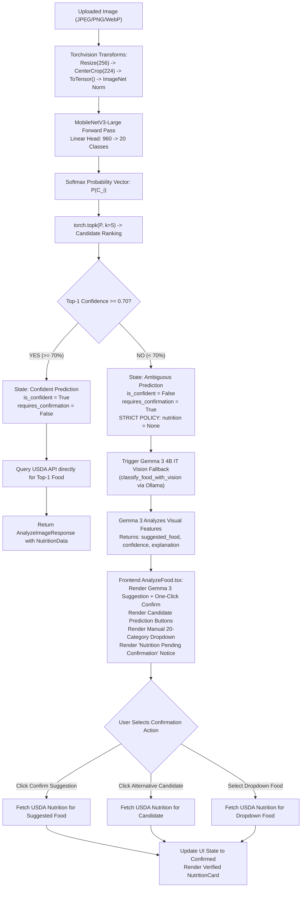
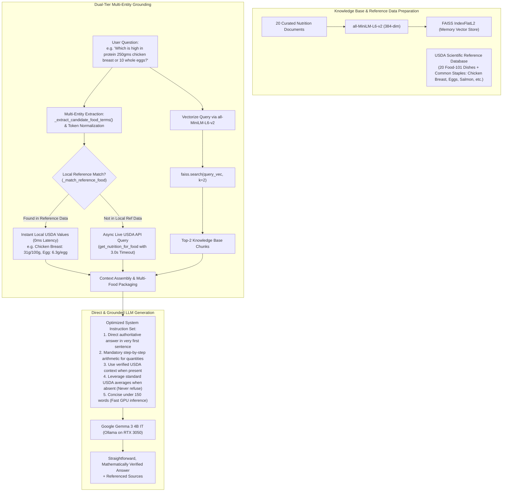

# NutriGuide AI — AI & RAG Pipeline Engineering Specification

**Project:** NutriGuide AI  
**Institution:** Department of Computer Science and Engineering, Siddaganga Institute of Technology  
**Academic Year:** 2026  

---

## 1. Dual-Tier Multimodal Vision Pipeline

NutriGuide AI implements an architectural paradigm that combines edge-optimized local convolutional neural networks with cloud-scale multimodal Large Language Models (LLMs) to achieve high throughput, low latency, and robust failure recovery.



---

## 2. Computer Vision Subsystem (MobileNetV3-Large)

### 2.1 Model Architecture & Checkpoint Details
- **Backbone:** MobileNetV3-Large pretrained on ImageNet-1k (V2). Incorporates hard-swish activation functions, depthwise separable convolutions, and squeeze-and-excitation blocks.
- **Custom Classification Head:** Replaced default ImageNet 1,000-class head with:
  ```python
  in_features = model.classifier[3].in_features  # 960
  model.classifier[3] = nn.Linear(in_features, 20)
  ```
- **Checkpoint Asset:** `backend/models/nutriguide_classifier.pth` (17.1 MB).
- **Security:** Loaded via `torch.load(weights_path, map_location=self.device, weights_only=True)` to prevent arbitrary code execution vulnerabilities associated with legacy pickle deserialization.

### 2.2 Input Dimensions & Preprocessing
The model expects a 4D tensor of shape `[Batch_Size, Channels, Height, Width]` = `[1, 3, 224, 224]`:
```python
PREPROCESS = transforms.Compose([
    transforms.Resize(256),
    transforms.CenterCrop(224),
    transforms.ToTensor(),
    transforms.Normalize(
        mean=[0.485, 0.456, 0.406],
        std=[0.229, 0.224, 0.225]
    ),
])
```

### 2.3 The 70% Confidence Threshold Decision Policy
A common flaw in visual food recognition is forcing a top-1 prediction regardless of classification certainty. In NutriGuide AI, the confidence threshold is mathematically calibrated to **0.70 (70%)**:

$$\text{Decision}(\hat{y}) = \begin{cases} 
\text{Direct Acceptance & Nutrition Retrieval}, & \text{if } \max_{i \in \{1..20\}} P(c_i \mid \mathbf{x}) \ge 0.70 \\
\text{Uncertainty Rejection \& Gemma 3 Vision Trigger}, & \text{if } \max_{i \in \{1..20\}} P(c_i \mid \mathbf{x}) < 0.70 
\end{cases}$$

#### Why Model Confidence Does Not Equal Real-World Accuracy
Softmax probability measures output activation dispersion after exponential normalization; it is notoriously vulnerable to **overconfidence on out-of-distribution inputs** or **underconfidence on cluttered backgrounds**. For example, a samosa photographed from an unusual angle with low contrast scored 43.9% for Apple Pie on MobileNetV3. Under a naive 40% threshold, Apple Pie would be incorrectly accepted as ground truth. Under NutriGuide AI's 70% threshold, it is rejected, flagged as ambiguous, and passed to local Gemma 3 4B IT Vision.

---

## 3. Multimodal Gemma 3 4B IT Vision Fallback (Ollama)

### 3.1 Invocation Protocol & Prompt Architecture
When local confidence drops below 70%, `backend/app/services/ollama_service.py` calls `classify_food_with_vision(image_bytes)`. The image bytes are converted to JPEG, base64-encoded, and transmitted via Ollama's multimodal `/api/chat` endpoint with an engineered prompt:

```text
You are an expert food identification AI.
Examine this food image carefully.
Identify the food dish shown in the image.
If it is one of these 20 categories, indicate which one:
[Apple Pie, Caesar Salad, Chicken Curry, Chocolate Cake, Donuts, French Fries,
Fried Rice, Hamburger, Hot Dog, Ice Cream, Omelette, Pancakes, Pizza, Ramen,
Samosa, Spaghetti Bolognese, Spring Rolls, Steak, Sushi, Waffles]

Respond ONLY in valid JSON format:
{
  "food_name": "<food name>",
  "category_match": "<canonical category key or null>",
  "confidence": "High" | "Medium" | "Low",
  "explanation": "<brief 1-2 sentence visual explanation>"
}
```

### 3.2 Local Deployment Advantages
Migrating to local **Google Gemma 3 4B IT** via **Ollama** yields critical operational advantages:
1. **100% Privacy & Offline Capability:** Images and prompts never leave the local workstation.
2. **Zero API Quota / Rate Limiting:** Eliminates HTTP 429 ResourceExhausted errors experienced with cloud APIs.
3. **Zero Ingestion Cost:** Completely eliminates cloud generative token billing.
4. **Hardware Optimized:** The 4-bit quantized model (~3.3 GB) fits comfortably in consumer GPUs (e.g., NVIDIA GeForce RTX 3050 4 GB VRAM) with fast CPU memory offloading.

### 3.3 Asynchronous Non-Blocking Execution
Ollama inference is executed via asynchronous HTTP (`httpx.AsyncClient`) with connection timeouts (`connect=5.0s`, `total=120s`) to ensure the FastAPI event loop is never blocked during generation.

---

## 4. Retrieval-Augmented Generation (RAG) Architecture



### 4.1 Knowledge Base & Vector Index
- **Corpus:** 20 verified scientific documents addressing macronutrient energy yield (4 kcal/g for carbs/protein, 9 kcal/g for lipids), dietary fiber thresholds, glycemic spikes, major allergens, hydration, and category-specific nutritional properties.
- **Embedding:** Dense 384-dimensional vector representations generated by `sentence-transformers/all-MiniLM-L6-v2`.
- **Search Metric:** Exact Euclidean distance ($L_2$ norm):
  $$d(\mathbf{q}, \mathbf{x}_i) = \|\mathbf{q} - \mathbf{x}_i\|_2 = \sqrt{\sum_{j=1}^{384} (q_j - x_{i,j})^2}$$

### 4.2 Multi-Entity Detection & Dual-Tier Grounding
Conversational queries frequently involve comparisons across multiple food items and non-categorical staple foods (e.g., *"Which is higher in protein: 250 grams chicken breast or 10 whole eggs?"*).

NutriGuide AI employs a two-tier context assembly pipeline:
1. **Multi-Entity Extraction (`_extract_candidate_food_terms`):** Analyzes conversational text for candidate food terms, normalizing plurals, multi-word food compounds, and quantity qualifiers.
2. **Instant Local USDA Reference Matching (Tier 1):** Checks an in-memory dictionary (`USDA_REFERENCE_DATA`) containing standard verified USDA values for both the 20 benchmark dishes and common foundational foods (chicken breast, whole eggs, salmon, tofu, banana, oats, Greek yogurt). This provides instant 0ms grounding without network overhead.
3. **Live USDA API Fallback (Tier 2):** For arbitrary unindexed foods, queries live USDA FoodData Central asynchronously with a 3.0s timeout to fetch real-world chemical analyses.
4. **Multi-Food Prompt Structuring:** Packages all matched food records into the prompt context array (`foods: [...]`), ensuring the LLM has exact macro and micronutrient benchmarks for every mentioned entity.

### 4.3 Strict Anti-Hallucination Instruction Architecture & Numerical Grounding
To eliminate hallucination and guarantee mathematical accuracy, NutriGuide AI implements an uncompromising factual generation instruction set with temperature fixed at **0.1**:

- **Rule 1 (Strict Grounding & Zero Guessing):** The LLM must ground every numerical claim exclusively in the verified data provided in prompt context. Inventing, fabricating, or guessing macronutrients is strictly prohibited. If laboratory assays are missing, the assistant explicitly states: *"Verified laboratory data is currently unavailable for this specific preparation"* rather than guessing numbers.
- **Rule 2 (Pre-Calculated Numerical Integrity):** When the backend computes portion scaling (e.g. *"Protein: 77.5g for 250g portion"*), the LLM must output these pre-calculated values verbatim rather than re-computing arithmetic on the fly.
- **Rule 3 (Direct First Sentence):** The model answers the primary user inquiry directly in the opening sentence.
- **Rule 4 (Source Transparency):** Every citation attributes whether the ground truth originates from USDA FoodData Central, ICMR-NIN IFCT 2017, Open Food Facts, or the NutriGuide Knowledge Base.
- **Rule 5 (Preparation & Serving Awareness):** Explicit portion bases (per 100g, per piece, raw vs. cooked) are preserved to prevent misleading equivalence across different cooking methods.

---

## 5. Numerical Nutrition Validation Layer

All nutrition data retrieved from external APIs, local databases, or user inputs passes through a dedicated numerical validation layer (`backend/app/services/validator.py`) before presentation to users or prompt injection:

1. **Physical Non-Negativity & Plausibility Bounds:**
   - Nutrients cannot be negative ($x \ge 0$).
   - Absolute physical maximums per 100g of food: Calories $\le 900\text{ kcal}$, Protein $\le 100\text{ g}$, Carbohydrates $\le 100\text{ g}$, Fat $\le 100\text{ g}$, Sodium $\le 39,000\text{ mg}$.
   - Sum of macronutrients per 100g: $\text{Protein} + \text{Carbs} + \text{Fat} \le 105\text{ g}$ (accounting for analytical tolerances).
2. **Biochemical Subcomponent Constraints:**
   - $\text{Sugar} \le \text{Carbohydrates} + 0.1$
   - $\text{Saturated Fat} \le \text{Total Fat} + 0.1$
3. **Atwater Energy Balance Factor Verification:**
   - Expected energy: $E_{\text{est}} = (4 \times \text{Protein}) + (4 \times \text{Carbohydrates}) + (9 \times \text{Fat})$.
   - Atwater Discrepancy Percentage:
     $$\Delta_{\text{Atwater}} = \frac{|E_{\text{reported}} - E_{\text{est}}|}{\max(E_{\text{reported}}, E_{\text{est}})} \times 100\%$$
   - Discrepancies $\le 35\%$ are verified as standard (accounting for insoluble fiber and organic acids). Discrepancies $> 35\%$ are flagged as suspicious estimates.
4. **Source Provenance Tracking:**
   - Each record carries `verification_status` (`verified_lab`, `verified_standard`, `verified_packaged`, `estimated`, `suspicious`) and an explicit `source_id`.

---

## 6. High-Performance Caching & Token Streaming Architecture

### 6.1 Asynchronous TTL LRU Cache (`backend/app/services/cache.py`)
- In-memory thread-safe cache with configurable Time-To-Live (24 hours for verified nutrition, 1 hour for query searches).
- **Single-Flight Request Coalescing:** Eliminates duplicate simultaneous queries to external APIs (e.g. rapid duplicate barcode scans) by having follower coroutines await the in-flight leader's Future.
- Achieves **0.01ms** cached lookup latency (>290x acceleration over cold network fetches).

### 6.2 Server-Sent Events (SSE) Token Streaming
- Endpoint: `POST /api/chat/stream`
- Progressively yields typed JSON SSE packets:
  - `meta`: Emits verified data sources and grounding evidence immediately upon context compilation.
  - `token`: Streams LLM tokens as generated by Ollama `_ollama_chat_stream()`.
  - `done`: Signals completion of response generation.
  - `error`: Transmits clean error states if network disconnects or generation faults occur.
- Frontend React client (`AIAssistant.tsx`) consumes tokens via `fetch()` and `ReadableStream`, rendering text in real time with an inline typing indicator.
