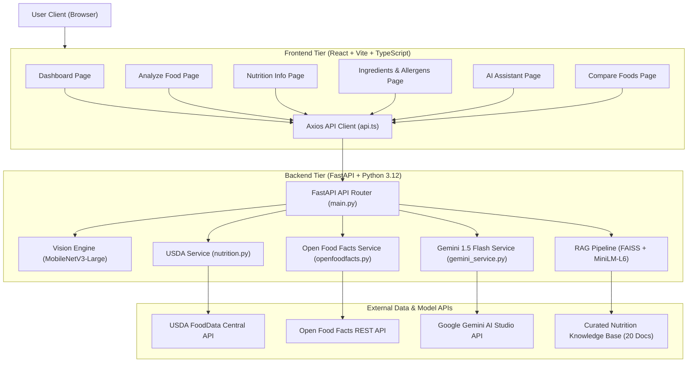
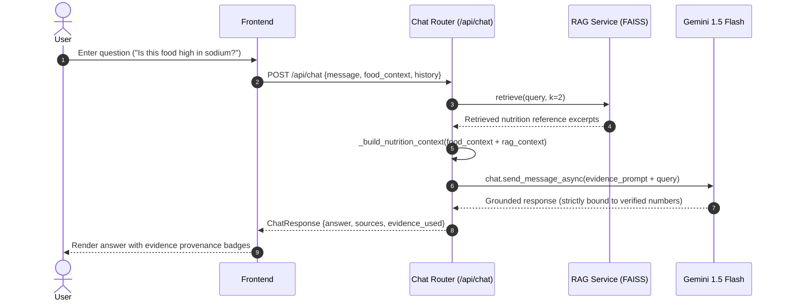

# NutriGuide AI — System Architecture & Design Specification

**Application Name:** NutriGuide AI  
**Academic Target:** Department of Computer Science & Engineering, Siddaganga Institute of Technology (2026)  
**System Type:** Multimodal Generative AI Full-Stack Web Application  

---

## 1. System Overview & Core Architecture

NutriGuide AI integrates Computer Vision, Structured Nutrition Retrieval, Community Packaged Food Databases, Vector-based Retrieval-Augmented Generation (RAG), and Generative AI into a unified web application.



---

## 2. Tier Responsibilities

### 2.1 Frontend Tier (`frontend/`)
- **Technology:** React 19, TypeScript, Vite 8, Tailwind CSS v4, Lucide React, Axios.
- **Responsibilities:**
  - Responsive visual design adhering strictly to the forest-green (`#0d2818`) and emerald-accent (`#52b788`) design system.
  - Image acquisition, client-side format/size validation (<10MB, JPEG/PNG/WebP), and drag-and-drop file upload.
  - Interactive data visualization (macronutrient breakdown, per-100g basis display, calorie callout).
  - Multi-turn conversational interface for the AI assistant with conversation history retention.
  - Side-by-side comparative tables with dynamic superiority indicators.
  - Transparent representation of uncertainty (confidence badges, missing fields alerts, allergen absence disclaimers).

### 2.2 Backend Tier (`backend/`)
- **Technology:** FastAPI, Uvicorn, Pydantic v2, PyTorch, Torchvision, HTTPX.
- **Responsibilities:**
  - RESTful API routing, payload validation, and HTTP error normalization.
  - Preprocessing uploaded images for PyTorch tensor input (`Resize(256)`, `CenterCrop(224)`, ImageNet normalization).
  - Computer vision inference with MobileNetV3-Large and confidence thresholding (cutoff: 40%).
  - Food name normalization and entity mapping to USDA search targets.
  - Asynchronous querying of USDA FoodData Central and Open Food Facts.
  - Vector embedding generation and semantic similarity search using FAISS.
  - Evidence-grounded prompt compilation for Gemini 1.5 Flash preventing numerical hallucination.

---

## 3. Data Flow & Sequential Pipelines

### 3.1 Multimodal Food Recognition & Analysis Flow

```mermaid
sequenceDiagram
    autonumber
    actor User
    participant Frontend
    participant API as FastAPI Router
    participant CV as MobileNetV3 Classifier
    participant USDA as USDA Service
    participant Gemini as Gemini Assistant

    User->>Frontend: Upload food photo
    Frontend->>API: POST /api/analyze (multipart/form-data)
    API->>CV: predict(image_bytes)
    CV-->>API: {predicted_class: 'pizza', confidence: 0.84, is_confident: true}
    alt is_confident == true
        API->>USDA: get_nutrition_for_food('Pizza', category_key='pizza')
        USDA-->>API: NutritionData (calories: 266, protein: 10.5g, basis: per 100g)
    else is_confident == false
        API-->>Frontend: Return low-confidence warning; prompt user confirmation
    end
    API-->>Frontend: AnalyzeImageResponse
    Frontend-->>User: Render prediction, confidence badge, & NutritionCard
```

### 3.2 Evidence-Grounded RAG Assistant Flow



---

## 4. Subsystem Details

### 4.1 Computer Vision Pipeline
- **Backbone Architecture:** MobileNetV3-Large with an inverted residual bottleneck structure and squeeze-and-excitation blocks.
- **Classifier Head:** Custom linear projection layer mapping bottleneck features to $N=20$ Food-101 target classes.
- **Inference Preprocessing:**
  $$\text{Image} \xrightarrow{\text{RGB}} \text{Resize}(256) \xrightarrow{} \text{CenterCrop}(224) \xrightarrow{} \text{Normalize}(\mu, \sigma) \xrightarrow{} \text{Softmax}(\mathbf{z})$$
- **Uncertainty Decision Policy:**
  $$\text{Status} = \begin{cases} \text{Accepted}, & \text{if } \max_i P(c_i) \ge 0.40 \\ \text{Ambiguous / Confirmation Required}, & \text{if } \max_i P(c_i) < 0.40 \end{cases}$$

### 4.2 Nutrition Retrieval & Entity Normalization
- **Primary Source:** USDA FoodData Central (Foundation, SR Legacy, FNDDS datasets).
- **Standardized Basis:** All values normalized per **100 grams** to guarantee comparability across diverse portion sizes.
- **Target Nutrient Identifiers (USDA FDC IDs):**
  - Energy: `ID 1008` (kcal)
  - Protein: `ID 1003` (g)
  - Carbohydrates: `ID 1005` (g)
  - Total Lipids (Fat): `ID 1004` (g)
  - Sugars: `ID 2000` (g)
  - Dietary Fiber: `ID 1079` (g)
  - Sodium: `ID 1093` (mg)
  - Cholesterol: `ID 1253` (mg)
  - Saturated Fat: `ID 1258` (g)

### 4.3 Packaged Food & Allergen Engine
- **Primary Source:** Open Food Facts global database.
- **Search Modes:** Full-text product name search and EAN-13/UPC barcode lookup.
- **Safety Policy:** Absence of allergen data does *not* constitute allergen-free status. The system flags incomplete records and presents an alert advising verification against physical packaging.

### 4.4 Generative AI & Retrieval-Augmented Generation (RAG)
- **Model:** Google Gemini 1.5 Flash (`gemini-1.5-flash`).
- **Embedding Model:** `all-MiniLM-L6-v2` (384-dimensional dense vectors).
- **Vector Search Index:** FAISS $L_2$ Euclidean Flat Index.
- **Hallucination Prevention:** The LLM prompt explicitly delineates verified ground truth from general nutrition principles, requiring the model to cite unavailability rather than guessing unlisted values.

---

## 5. Security & Safety Architecture
- **Environment Isolation:** API keys and credentials are kept in `.env` and loaded via typed settings. Secrets are excluded from version control via `.gitignore`.
- **Payload Validation:** Maximum file upload size capped at 10 MB; MIME-type whitelisting enforces JPEG/PNG/WebP format integrity.
- **Medical Disclaimer:** The system prominently features academic project notices on all pages, clarifying that NutriGuide AI provides educational nutrition analysis and does not constitute medical advice.
