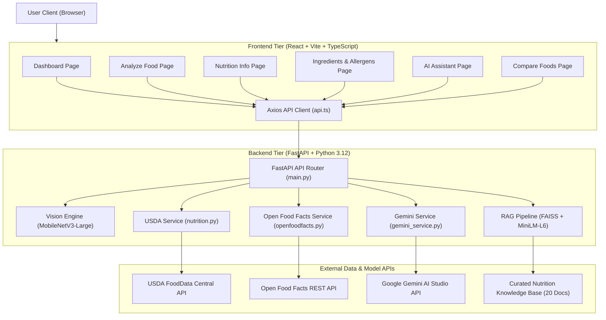
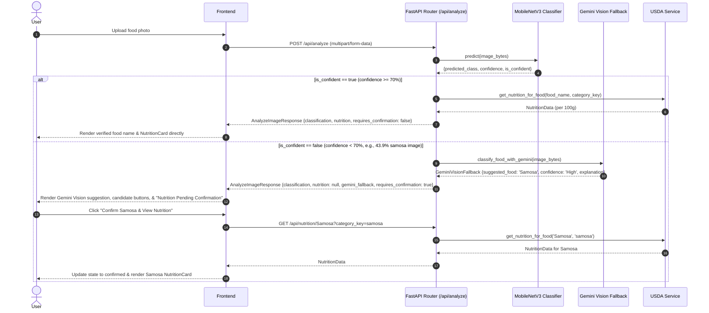

# NutriGuide AI — System Architecture & Design Specification

**Application Name:** NutriGuide AI  
**Academic Target:** Department of Computer Science & Engineering, Siddaganga Institute of Technology (2026)  
**System Type:** Multimodal Generative AI Full-Stack Web Application  

---

## 1. System Overview & Core Architecture

NutriGuide AI integrates Computer Vision, Structured Nutrition Retrieval, Community Packaged Food Databases, Vector-based Retrieval-Augmented Generation (RAG), and Generative AI into a unified web application.

---

## 2. Tier Responsibilities

### 2.1 Frontend Tier (`frontend/`)
- **Technology:** React 19, TypeScript, Vite 8, Tailwind CSS v4, Lucide React, Axios.
- **Responsibilities:**
  - Responsive visual design adhering strictly to the forest-green (`#0d2818`) and emerald-accent (`#52b788`) design system.
  - Image acquisition, client-side format/size validation (<10MB, JPEG/PNG/WebP), and drag-and-drop file upload.
  - Interactive data visualization (macronutrient breakdown, per-100g basis display, calorie callout).
  - Multi-turn conversational interface for the AI assistant with conversation history retention.
  - Side-by-side comparative tables with dynamic superiority indicators.
  - Transparent representation of uncertainty (confidence badges, missing fields alerts, allergen absence disclaimers).
  - Interactive confirmation workflows: one-click "Confirm & View Nutrition" button on Gemini Vision cards, candidate selection buttons, and manual category override dropdown.
  - Safe nutritional display: pending confirmation placeholder withholding nutrition data for unconfirmed foods.

### 2.2 Backend Tier (`backend/`)
- **Technology:** FastAPI, Uvicorn, Pydantic v2, PyTorch, Torchvision, HTTPX.
- **Responsibilities:**
  - RESTful API routing, payload validation, and HTTP error normalization.
  - Preprocessing uploaded images for PyTorch tensor input (`Resize(256)`, `CenterCrop(224)`, ImageNet normalization).
  - Computer vision inference with fine-tuned MobileNetV3-Large and confidence thresholding (`CONFIDENCE_THRESHOLD = 0.70`).
  - Multimodal Gemini Vision fallback automatically triggered on low-confidence image predictions ($< 70\%$).
  - Strict nutrition policy: withholding definitive USDA nutrition information (`nutrition = None`) when identification is unconfirmed.
  - Food name normalization and entity mapping to USDA search targets.
  - Asynchronous querying of USDA FoodData Central and Open Food Facts with multi-host failover.
  - Vector embedding generation and semantic similarity search using FAISS.
  - Evidence-grounded prompt compilation for Gemini preventing numerical hallucination.

---

## 3. Data Flow & Sequential Pipelines

### 3.1 Multimodal Food Recognition & Confirmation Flow

---

## 4. Subsystem Details

### 4.1 Computer Vision & Classification Engine
- **Backbone Architecture:** MobileNetV3-Large with an inverted residual bottleneck structure and squeeze-and-excitation blocks. Pretrained on ImageNet-1k (V2).
- **Custom Classification Head:** Linear projection layer mapping 960 bottleneck features to $N=20$ target Food-101 classes.
- **Model Checkpoint:** `backend/models/nutriguide_classifier.pth` (17.1 MB), loaded with `weights_only=True` for security.
- **Empirical Accuracy:** **90.64% Top-1** and **97.82% Top-3** measured on 5,000 unseen test images (up from 2.60% baseline).
- **Inference Preprocessing:**
  $$\text{Image} \xrightarrow{\text{RGB}} \text{Resize}(256) \xrightarrow{} \text{CenterCrop}(224) \xrightarrow{} \text{Normalize}(\mu, \sigma) \xrightarrow{} \text{Softmax}(\mathbf{z})$$
- **Uncertainty Decision Policy:**
  $$\text{Status} = \begin{cases} \text{Accepted Directly}, & \text{if } \max_i P(c_i) \ge 0.70 \\ \text{Ambiguous / Confirmation Required}, & \text{if } \max_i P(c_i) < 0.70 \end{cases}$$
- **Multimodal Gemini Vision Fallback:**
  - When local confidence is below 70%, `classify_food_with_gemini(image_bytes)` sends the image to Google Gemini Vision.
  - Gemini Vision analyzes the visual features, detects the dish name, maps to one of the 20 classes if applicable, and explains observed visual characteristics.
  - The suggestion is returned in `gemini_fallback` separately from the local classifier prediction.
- **Strict Nutrition Withholding Policy:**
  - Definitive nutrition information is withheld (`nutrition = None`) until the user confirms the food identity.
- **Interactive UI Correction:**
  - One-click confirmation button on the Gemini Vision suggestion card.
  - Clickable "Select" buttons for each candidate prediction.
  - Manual category correction dropdown listing all 20 supported foods.

### 4.2 Nutrition Retrieval & Entity Normalization
- **Primary Source:** USDA FoodData Central (Foundation, SR Legacy, FNDDS datasets).
- **Standardized Basis:** All values normalized per **100 grams** to guarantee comparability across diverse portion sizes.
- **Target Nutrient Identifiers (USDA FDC IDs):**
  - Energy: `ID 1008` (kcal)
  - Protein: `ID 1003` (g)
  - Carbohydrates: `ID 1005` (g)
  - Total Lipids (Fat): `ID 1004` (g)
  - Sugars: `ID 2000` (g)
  - Dietary Fiber: `ID 1079` (g)
  - Sodium: `ID 1093` (mg)
  - Cholesterol: `ID 1253` (mg)
  - Saturated Fat: `ID 1258` (g)

### 4.3 Packaged Food & Allergen Engine
- **Primary Source:** Open Food Facts global database.
- **Search Modes:** Full-text product name search and EAN-13/UPC barcode lookup.
- **Multi-Host Resilience:** Automatic failover between `world.openfoodfacts.net` and `world.openfoodfacts.org` with compliant User-Agent headers.
- **Safety Policy:** Absence of allergen data does *not* constitute allergen-free status. The system flags incomplete records and presents an alert advising verification against physical packaging.

### 4.4 Generative AI & Retrieval-Augmented Generation (RAG)
- **Model:** Google Gemini with candidate model hierarchy:
  1. `gemini-3.5-flash` (primary, fast ~2.0s inference)
  2. `gemini-3.5-flash-lite`
  3. `gemini-3.1-flash-lite`
  4. `gemini-flash-latest`
  5. `gemini-3.8-flash`
- **Execution Mechanism:** Thread-pool execution via `asyncio.to_thread(chat.send_message, ...)` with a 10.0-second timeout, ensuring gRPC thread isolation and eliminating event-loop conflicts.
- **Embedding Model:** `all-MiniLM-L6-v2` (384-dimensional dense vectors).
- **Vector Search Index:** FAISS $L_2$ Euclidean Flat Index over curated nutrition domain knowledge.
- **Auto-Grounding Pipeline:** Automatically identifies food entities in conversational questions (e.g., "fried rice", "pizza") and injects verified USDA reference data alongside RAG principles into prompt context.
- **Hallucination Prevention:** The LLM prompt explicitly delineates verified ground truth from general nutrition principles, requiring the model to cite unavailability rather than guessing unlisted values.

---

## 5. Security & Safety Architecture
- **Environment Isolation:** API keys and credentials are kept in `backend/.env` and loaded via typed settings with absolute path resolution. Secrets are excluded from version control via `.gitignore`.
- **Credential Protection:** `Settings.__repr__` masks secrets as `"***"` to eliminate accidental key leakage into server logs or test traces.
- **Payload Validation:** Maximum file upload size capped at 10 MB; MIME-type whitelisting enforces JPEG/PNG/WebP format integrity.
- **Medical Disclaimer:** The system prominently features academic project notices on all pages, clarifying that NutriGuide AI provides educational nutrition analysis and does not constitute medical advice.
