# NutriGuide AI — Limitations & Future Scope

**Project:** NutriGuide AI  
**Institution:** Department of Computer Science and Engineering, Siddaganga Institute of Technology  
**Academic Year:** 2026  

---

## 1. Current System Limitations

While NutriGuide AI achieves high classification accuracy, rapid inference latency, and strict evidence grounding, an objective engineering assessment reveals several operational boundaries:

### 1.1 Computer Vision & Classification Boundaries
1. **Edge Classification Domain & Vision Fallback:** The local MobileNetV3-Large model operates on the 20 primary Food-101 benchmark classes at 26.9ms edge latency. To support general-purpose food identification beyond these 20 classes, the system integrates the full 101-class taxonomy alongside the open-vocabulary **Gemma 3 4B IT Vision** fallback. Discarding forced classifications prevents misidentification of unsupported regional dishes.
2. **Lack of Volumetric / Portion Size Estimation:** The vision system performs 2D category classification, not 3D depth or density reconstruction. Consequently, the system outputs standardized **per-100g** metrics or discrete unit counts (e.g. per roti, per egg) rather than automatically estimating the exact physical gram weight of food on the user's plate.
3. **Occlusion & Composite Meal Challenges:** Plates containing multiple overlapping items (e.g., rice, curry, and bread simultaneously) are classified under the dominant visual class or referred to open-vocabulary vision identification rather than being segmented into discrete instance masks.

### 1.2 Upstream Data & API Dependencies
1. **Local Offline Autonomy:** Local MobileNetV3 classification, RAG retrieval, and the curated 120+ Indian and global food SQLite database operate 100% offline. Live USDA FoodData Central and Open Food Facts lookups require an active internet connection, though all fetched records are cached locally with a 24-hour TTL (0.01ms cached lookup).
2. **Open Food Facts Regional Coverage:** Product coverage is comprehensive for European and North American consumer goods, but certain local Indian packaged foods have incomplete ingredient or allergen entries in the public database.
3. **USDA Serving Portion Variance:** Some processed foundation foods in USDA FoodData Central list values with minor analytical rounding differences depending on whether survey data or chemical foundation assays were conducted. Every record is verified by NutriGuide's Atwater 4-4-9 validation layer before presentation.

### 1.3 Conversational Intelligence Boundaries
1. **Stateless Conversational Memory:** The chat assistant maintains multi-turn context within the active browser session (up to 8 historical exchanges), but does not persist conversations across page reloads or different devices.
2. **Strict Medical Disclaimer:** The system provides educational nutritional intelligence and does not provide clinical medical advice, disease management (e.g., insulin bolus calculations), or prescription diets.

---

## 2. Future Scope & Research Roadmap

```mermaid
flowchart LR
    subgraph NearTerm["Phase 1: Near-Term Enhancements (6 Months)"]
        N1["Scale Classifier to 101 Food-101 Classes"]
        N2["Bounding Box Detection via YOLOv11"]
        N3["User Profile & Dietary Preferences"]
    end

    subgraph MidTerm["Phase 2: Mid-Term Enhancements (12 Months)"]
        M1["Depth Estimation & 3D Portion Sizing"]
        M2["Micro-Service Containerization (Docker/K8s)"]
        M3["Regional Indian Food Dataset Expansion"]
    end

    subgraph LongTerm["Phase 3: Long-Term Horizon (24 Months)"]
        L1["Continuous Wearable Integration (Apple Health/Fitbit)"]
        L2["Edge Vision Deployment (ONNX Web / CoreML)"]
        L3["Personalized Glycemic Response Prediction"]
    end

    NearTerm --> MidTerm --> LongTerm
```

### 2.1 Scale Classifier to 101 Categories & Beyond
- Fine-tune modern vision backbones (e.g., ConvNeXt-Tiny or MobileNetV4) on the entire 101-class Food-101 dataset, incorporating Indian cuisine benchmarks (e.g., Food-201, IndianFoodDataset).
- Implement multi-label classification to identify compound meals containing multiple sides on a single platter.

### 2.2 Object Detection & Instance Segmentation
- Deploy **YOLOv11** or **Mask R-CNN** to generate oriented bounding boxes and pixel-level instance masks for every distinct food item on a plate, allowing simultaneous multi-food nutritional aggregation.

### 2.3 Monocular 3D Volumetric Portion Sizing
- Utilize monocular depth estimation models (e.g., Depth Anything, MiDaS) combined with visual reference fiducials (e.g., credit card or standard dining fork) to calculate food volume in cubic centimeters ($\text{cm}^3$), estimating real physical mass using known density coefficients ($\rho = \text{mass} / \text{volume}$).

### 2.4 Browser-Native Edge Inference via ONNX Web / WebGPU
- Export the fine-tuned PyTorch model to **ONNX Web** or **TensorFlow.js**, enabling the browser to perform real-time camera inference locally using WebGPU without uploading image bytes to the server.

### 2.5 Personalized Nutrition & Wearable Biometric Integration
- Enable optional authenticated profiles allowing users to set personalized targets (e.g., ketogenic, low-FODMAP, diabetic carb monitoring).
- Integrate with HealthKit and Google Health Connect to correlate dietary intake with continuous glucose monitoring (CGM) and physical activity telemetry.
