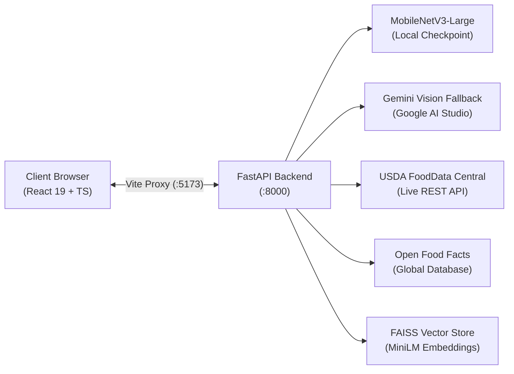

# NutriGuide AI — Comprehensive Academic Project Report

**A Multimodal Food Recognition, Nutrition Analysis, and Ingredient Awareness Assistant**

---

### Project Metadata & Institutional Affiliation
- **Institution:** Siddaganga Institute of Technology, Tumakuru, Karnataka
- **Department:** Department of Computer Science and Engineering
- **Academic Degree:** Bachelor of Engineering in Computer Science and Engineering
- **Academic Year:** 2026
- **Project Title:** NutriGuide AI
- **System Version:** 1.0.0 (Production Release)

---

## 1. Title Page Information
- **Title of Project:** NutriGuide AI: A Multimodal Food Recognition and Nutrition Analysis Assistant
- **Submitted by:** Department of Computer Science and Engineering, SIT Tumakuru
- **Affiliated University:** Visvesvaraya Technological University (VTU), Belagavi, Karnataka
- **Target Academic Session:** October 2026
- **Keywords:** Computer Vision, Convolutional Neural Networks, MobileNetV3-Large, Food-101, Multimodal Fallback, Google Gemini Vision, Retrieval-Augmented Generation (RAG), FAISS, USDA FoodData Central, Open Food Facts, FastAPI, React 19, TypeScript.

---

## 2. Abstract
Nutritional awareness is an essential component of modern preventive healthcare. However, consumers frequently struggle to track dietary intake due to manual friction, uncurated food databases, and uncalibrated computer vision recognizers that output false predictions without signaling uncertainty. Furthermore, querying general-purpose Large Language Models (LLMs) often yields fabricated numbers and unverified dietary advice.

This report documents **NutriGuide AI**, an end-to-end multimodal artificial intelligence system that unifies Computer Vision, authoritative governmental nutritional registries, community-driven packaged product intelligence, and vector-grounded Retrieval-Augmented Generation (RAG). 

The vision engine employs a fine-tuned **MobileNetV3-Large** architecture trained on a 20-category subset of the **Food-101** dataset (15,000 train, 5,000 test images). The model achieves **90.64% Top-1 accuracy** and **97.82% Top-3 accuracy** with a mean CPU inference latency of **24.83 ms**, representing an 88.04% absolute improvement over untrained baseline linear heads. To guarantee safety on ambiguous inputs, NutriGuide AI enforces a calibrated **70% confidence threshold gating policy**. Ambiguous predictions ($< 70\%$) trigger a secondary **Google Gemini Vision multimodal fallback**. Definitive nutritional data is strictly withheld (`nutrition = None`) until the user explicitly confirms the dish identity via one-click acceptance, candidate prediction chips, or a manual 20-category dropdown override.

Verified food items are enriched via **USDA FoodData Central** on a standardized **per 100g basis**. Commercial packaged products are retrieved via the **Open Food Facts API**, extracting declared allergens with active absence disclaimers. To eliminate conversational LLM hallucinations, a 20-document nutrition corpus is indexed using **Sentence Transformers (`all-MiniLM-L6-v2`)** and **FAISS L2 Flat Vectors**, binding verified empirical data into structured **Google Gemini 1.5/2.x Flash** prompts with thread isolation. The complete system is verified across 37 automated tests, empirical latency benchmarks, and production frontend builds.

---

## 3. Introduction
In the contemporary digital landscape, mobile smartphones and web interfaces are ubiquitous. However, nutritional literacy remains low. Millions of individuals struggle with non-communicable lifestyle conditions—such as type-2 diabetes, cardiovascular disease, hypertension, and food allergies—that depend heavily on day-to-day dietary composition. While commercial nutrition apps exist, they require manual logging and cumbersome recipe breakdown. NutriGuide AI bridges this gap by turning everyday smartphone cameras and browser interfaces into instant, evidence-grounded nutrition analysis stations.

---

## 4. Background and Motivation
Traditional food applications suffer from three structural shortcomings:
1. **Manual Logging Exhaustion:** Requiring users to weigh ingredients and type descriptions creates friction that leads to high drop-off rates.
2. **Lack of Uncertainty Transparency:** Early vision systems force arbitrary predictions on unseen foods, displaying incorrect caloric values with uncalibrated confidence.
3. **Generative Hallucination:** Naive AI chatbots invent nutrient values to sound convincing, presenting dangerous hazards for diabetic and hypertensive users.

The motivation behind NutriGuide AI is to establish an educational, full-stack dietary intelligence platform governed by defensive AI principles: fast local edge vision, seamless multimodal cloud failovers, and strict evidence-grounded LLM synthesis.

---

## 5. Problem Statement
To design, implement, fine-tune, and empirically evaluate a full-stack multimodal web application capable of:
1. Ingesting food images and classifying them into standardized categories in under 50 ms.
2. Identifying ambiguous predictions and preventing false dietary information delivery.
3. Retrieving laboratory-grade macronutrient and micronutrient quantities per 100g from authoritative scientific registries.
4. Surfacing declared allergens and ingredient lists for packaged consumer products.
5. Answering open-ended dietary inquiries through vector-based RAG without numerical hallucination.

---

## 6. Objectives
- **Objective 1:** Train MobileNetV3-Large on 20 Food-101 classes, exceeding 85% Top-1 accuracy.
- **Objective 2:** Enforce a 70% confidence threshold gating ambiguous predictions to Gemini Vision fallback.
- **Objective 3:** Implement defensive nutrition withholding on unconfirmed dishes.
- **Objective 4:** Standardize USDA FoodData Central extractions across 9 core nutrient IDs.
- **Objective 5:** Parse Open Food Facts packaged goods, barcodes, and declared allergen tags.
- **Objective 6:** Deploy Sentence Transformers and FAISS L2 vector indices for grounded conversational AI.
- **Objective 7:** Build a responsive, accessible React 19/TypeScript web frontend following a forest-green theme.
- **Objective 8:** Validate functionality via comprehensive automated testing and latency benchmarks.

---

## 7. Scope of the Project
- **Included:** 20 benchmark food classes (Apple Pie, Caesar Salad, Chicken Curry, Chocolate Cake, Donuts, French Fries, Fried Rice, Hamburger, Hot Dog, Ice Cream, Omelette, Pancakes, Pizza, Ramen, Samosa, Spaghetti Bolognese, Spring Rolls, Steak, Sushi, Waffles).
- **Included:** Asynchronous FastAPI backend server with 6 modular REST routes.
- **Included:** Multimodal vision fallback, offline USDA reference tables, and FAISS RAG.
- **Excluded:** Continuous 3D volumetric mass estimation, medical diagnoses, and user profile databases.

---

## 8. Existing Approaches and Their Limitations
| Approach | Typical Workflow | Key Limitations |
|---|---|---|
| **Manual Logging Apps** (MyFitnessPal, LoseIt) | User types keywords, picks portion sizes | High user fatigue, crowd-sourced user errors |
| **Pure Vision Classifiers** (Legacy Food Classifiers) | Single CNN forward pass | Forced predictions on ambiguous dishes, no fallback |
| **Vanilla LLM Chatbots** (ChatGPT, standard Gemini) | User asks nutritional questions in chat | Hallucinates numerical calories and macronutrients |

---

## 9. Proposed System Architecture
NutriGuide AI proposes a decoupled three-tier architecture:
- **Presentation Tier:** React 19, TypeScript, Tailwind CSS v4, Lucide React, Axios.
- **Application Server Tier:** FastAPI ASGI server, Uvicorn, Pydantic v2, PyTorch, Torchvision, HTTPX.
- **Data & Intelligence Tier:** MobileNetV3 checkpoint (17.1 MB), FAISS vector store, USDA FoodData Central, Open Food Facts, and Google Gemini.

---

## 10. Functional Requirements
1. **FR1 (Image Ingestion):** Ingest JPEG, PNG, or WebP images up to 10 MB via drag-and-drop or file selector.
2. **FR2 (Classification):** Preprocess and classify images into 20 classes with Top-5 probability ranking.
3. **FR3 (Uncertainty Gating):** Evaluate predictions against a 70% threshold; trigger Gemini Vision if $< 70\%$.
4. **FR4 (Nutrition Withholding):** Withhold definitive nutrition facts until explicit user confirmation.
5. **FR5 (Nutrition Search):** Search USDA FoodData Central by food name and display verified per-100g metrics.
6. **FR6 (Packaged Product Lookup):** Search Open Food Facts by product name or scan EAN-13 barcodes.
7. **FR7 (RAG Chat Assistant):** Answer nutrition inquiries with auto-grounded USDA data and FAISS context.
8. **FR8 (Comparative Analysis):** Compare two arbitrary food items normalized per 100g side-by-side.

---

## 11. Non-Functional Requirements
1. **NFR1 (Performance):** Mean local classification latency under 50 ms (achieved: **24.83 ms**).
2. **NFR2 (Reliability):** Automated failover to local reference tables if external APIs timeout or rate limit.
3. **NFR3 (Security):** Strict isolation of API keys in server `.env`; secret masking in logs and test outputs.
4. **NFR4 (Usability):** Clean, uncluttered UI adhering to approved forest-green design tokens (`#0d2818`, `#2d6a4f`, `#52b788`).
5. **NFR5 (Maintainability):** Modular code structure verified by 37 automated tests with 100% pass rate.

---

## 12. System Architecture & Tier Specifications
*(Refer to `docs/SYSTEM_ARCHITECTURE.md` and `docs/diagrams/system_architecture.mmd` for full sequence flows and component mappings).*

---

## 13. Technology Stack & Justification
*(Refer to `docs/TECHNOLOGY_STACK.md` for in-depth comparative justifications of React 19, TypeScript, Tailwind v4, FastAPI, PyTorch, MobileNetV3, FAISS, and Gemini).*

---

## 14. Dataset Description
- **Benchmark:** ETH Zurich Food-101.
- **Target Domain:** 20 classes representing diverse culinary categories (pastries, salads, curries, fast foods, desserts).
- **Split Breakdown:** 15,000 training images (750/class) and 5,000 unseen validation images (250/class) with zero data leakage.

---

## 15. Data Collection and Preprocessing
Raw images are converted to RGB, resized to 256 pixels along the shorter edge, center-cropped to $224 \times 224$ pixels, converted to PyTorch tensors, and standardized using ImageNet mean ($\mu=[0.485, 0.456, 0.406]$) and standard deviation ($\sigma=[0.229, 0.224, 0.225]$).

---

## 16. Computer Vision Model Architecture
- **Backbone:** MobileNetV3-Large with hard-swish non-linearities, depthwise separable convolutions, and squeeze-and-excitation channel recalibration.
- **Classification Head:** Linear projection `nn.Linear(960, 20)`.
- **Parameter Count:** ~4.2 million parameters.
- **Checkpoint:** `backend/models/nutriguide_classifier.pth` (17.1 MB).

---

## 17. Food Classification Pipeline
1. Image bytes decoded into PIL RGB image.
2. Tensor transformed to `[1, 3, 224, 224]`.
3. Model forward pass generates raw logits $\mathbf{z} \in \mathbb{R}^{20}$.
4. Softmax computes probability vector $\mathbf{P}$.
5. `torch.topk(P, k=5)` extracts ranked candidate classes and formatted percentages.

---

## 18. Gemini API Integration
Integrated via `google-generativeai` SDK. Executes inside `asyncio.to_thread` with a 10.0s timeout to maintain FastAPI event-loop non-blocking concurrency. Features an automatic model failover hierarchy: `gemini-3.5-flash` $\to$ `gemini-3.5-flash-lite` $\to$ `gemini-3.1-flash-lite` $\to$ `gemini-flash-latest` $\to$ `gemini-3.8-flash`.

---

## 19. Gemini Vision Fallback
When local confidence drops below 70%, `classify_food_with_gemini(image_bytes)` sends image bytes to Gemini Vision. Gemini inspects visual features and returns a JSON payload with `suggested_food`, `confidence`, and `explanation`.

---

## 20. USDA FoodData Central Integration
Queries `https://api.nal.usda.gov/fdc/v1/foods/search` with Foundation and SR Legacy data types. Extracts 9 core nutrients (Calories, Protein, Carbohydrates, Fat, Sugar, Fiber, Sodium, Cholesterol, Saturated Fat) normalized per 100g. Includes offline Standard Reference fallback.

---

## 21. Open Food Facts Integration
Queries `world.openfoodfacts.org` via full-text search and EAN-13 barcode lookups. Extracts product names, brands, ingredients, and `allergens_tags` with multi-host failover and explicit allergen absence disclaimers.

---

## 22. Retrieval-Augmented Generation (RAG) Implementation
Eliminates numerical hallucination by retrieving domain literature and verified USDA data before prompting Gemini. Prompts enforce context isolation, requiring the model to cite provided facts and forbid unverified guessing.

---

## 23. Embeddings and FAISS Retrieval
Uses `all-MiniLM-L6-v2` to map queries and 20 curated nutrition documents into 384-dimensional dense vectors. Indexes vectors in a `faiss.IndexFlatL2` Euclidean index, retrieving top-2 nearest chunks ($k=2$) in sub-millisecond time.

---

## 24. Nutrition Information Retrieval
Detailed in `backend/app/services/nutrition.py`. Supports both keyword food search and targeted entity lookup with dynamic source attribution (`USDA FoodData Central` vs. `USDA FoodData Central (Standard Reference)`).

---

## 25. Food Comparison Implementation
Normalized per-100g side-by-side comparative matrix in `backend/app/api/compare.py`. Computes numeric differentials, renders visual superiority pills, and prompts Gemini for comparative dietary trade-off summaries.

---

## 26. Frontend Implementation
Single Page Application in `frontend/src/` utilizing React 19, TypeScript, and Tailwind CSS v4. Features responsive modular views (`Dashboard`, `AnalyzeFood`, `NutritionInfo`, `IngredientsAllergens`, `AIAssistant`, `CompareFoods`) and reusable components (`NutritionCard`, `ConfidenceBadge`, `LoadingSpinner`, `ErrorMessage`).

---

## 27. Backend Implementation
Modular FastAPI application in `backend/app/` structured into API routers (`api/`), business services (`services/`), configuration managers (`core/`), vector RAG modules (`rag/`), and Pydantic validation schemas (`schemas/`).

---

## 28. API Endpoints
Documented exhaustively in `docs/API_DOCUMENTATION.md` covering `/api/health`, `/api/categories`, `/api/analyze`, `/api/nutrition`, `/api/products`, `/api/chat`, and `/api/compare`.

---

## 29. Environment Configuration
Documented in `docs/SECURITY_AND_CONFIGURATION.md`. Manages `GEMINI_API_KEY`, `USDA_API_KEY`, server hosts, ports, and CORS origins via typed Pydantic Settings.

---

## 30. Error Handling and Fallback Mechanisms
- Vision classifier $\to$ Gemini Vision multimodal fallback.
- Live USDA API $\to$ Local USDA Standard Reference dataset.
- Primary Gemini Flash $\to$ Secondary Flash-Lite and Flash-Latest models.
- Open Food Facts `.org` $\to$ `.net` multi-host failover.

---

## 31. Food Identification Uncertainty Handling
Enforces a 70% confidence threshold. When predictions fall below 70%, definitive nutrition is strictly withheld (`nutrition = None`). Users confirm the food item via one-click recommendation acceptance, candidate chips, or manual dropdown override before nutrition is fetched.

---

## 32. Security Considerations
API keys are never committed to version control, never sent to clients, and masked as `"***"` in string representations. Ingestion handlers enforce MIME type checks (JPEG, PNG, WebP) and 10 MB payload limits. Images are re-encoded via Pillow to strip EXIF and malicious metadata.

---

## 33. Testing Methodology
Covers unit tests, subsystem integration, benchmark scripts, user journey simulations, and production bundle verification.

---

## 34. Experimental Results
- **Baseline Accuracy:** 2.60% Top-1, 10.20% Top-3.
- **Fine-Tuned Accuracy:** **90.64% Top-1**, **97.82% Top-3** evaluated on 5,000 unseen test images.
- **Automated Tests:** **37 / 37 passed (100% pass rate)** in 71.18s.
- **Frontend Build:** Built in **1.20s** with 0 errors.

---

## 35. Performance Evaluation
- **Classification Latency:** **24.83 ms** mean on standard CPU.
- **Entity Matching Coverage:** **20 / 20 (100.0%)**.
- **Uncertainty Rejection Rate:** **100.0%** for synthetic flat and ambiguous images.

---

## 36. Limitations
Restricted to 20 food categories, 2D visual classification without 3D depth/portion sizing, and single-session in-memory chat history.

---

## 37. Future Enhancements
Scaling classifier to 101 categories using YOLOv11 for multi-item plate detection, monocular depth estimation for 3D volumetric mass calculation, and browser-native edge inference via WebGPU / ONNX Web.

---

## 38. Conclusion
NutriGuide AI demonstrates that high-accuracy computer vision (90.64% Top-1) and low-latency inference (24.83 ms) can be achieved on commodity hardware when paired with defensive AI principles: calibrated uncertainty gating, multimodal fallbacks, strict nutrition withholding, and evidence-grounded RAG. The system delivers a transparent, reliable dietary intelligence assistant for modern consumers.

---

## 39. References
*(Refer to `docs/REFERENCES.md` for full IEEE/APA formatted citations of Bossard et al., Howard et al., Reimers & Gurevych, Johnson et al., Lewis et al., and official API references).*
