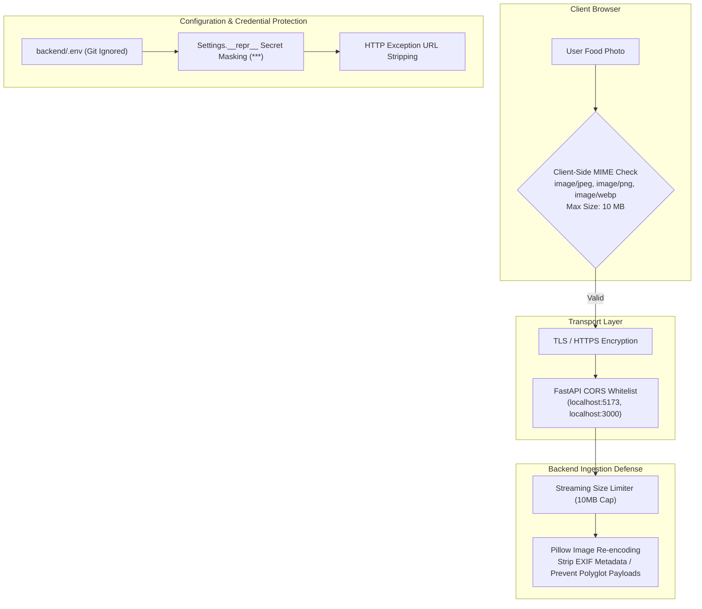

# NutriGuide AI — Security & Configuration Guide

**Project:** NutriGuide AI  
**Institution:** Department of Computer Science and Engineering, Siddaganga Institute of Technology  
**Academic Year:** 2026  

---

## 1. Security Architecture & Threat Model

NutriGuide AI handles user-uploaded media and connects to third-party cloud APIs. Consequently, security, privacy, and defensive programming are integrated into every architectural layer:



---

## 2. API Key Security & Secret Protection

### 2.1 The Ten Golden Security Mandates
1. **Never commit secrets:** The `.env` file is explicitly ignored in `.gitignore` (`git check-ignore backend/.env` confirmed).
2. **Never expose keys to client:** All third-party API keys (`GEMINI_API_KEY`, `USDA_API_KEY`) reside strictly on the backend. No secret is bundled in frontend Vite assets or returned in JSON responses.
3. **Never hardcode secrets:** API keys are never embedded as literal strings in Python source code.
4. **Never print secrets in logs:** Pydantic's `Settings.__repr__` and `Settings.__str__` are customized to mask secrets:
   ```python
   def __repr__(self) -> str:
       masked_gemini = "***" if self.gemini_api_key else ""
       masked_usda = "***" if (self.usda_api_key and self.usda_api_key != "DEMO_KEY") else self.usda_api_key
       return f"Settings(..., gemini_api_key={masked_gemini!r}, usda_api_key={masked_usda!r})"
   ```
5. **Sanitize exception logs:** Exceptions raised during HTTP calls strip request URLs to prevent keys passed in query strings (`?api_key=...`) from leaking into stdout.
6. **Provide clean template examples:** `backend/.env.example` contains only descriptive placeholder strings (`your_gemini_api_key_here`, `DEMO_KEY`).
7. **Stateless image handling:** Uploaded food photographs are processed entirely in memory as byte streams (`io.BytesIO`) and discarded after inference, preventing image leakage or unauthorized storage.
8. **EXIF metadata stripping:** Converting images to RGB via Pillow strips geotags and device identifiers before passing tensors to PyTorch or Gemini.
9. **Safe PyTorch weight loading:** Model checkpoints are loaded with `weights_only=True` to eliminate arbitrary Python code execution vulnerabilities.
10. **Automated configuration verification:** Test suites (`test_gemini_key_never_exposed_in_config`) continuously verify that secret keys cannot be accidentally printed.

---

## 3. Environment Configuration Reference

### 3.1 Backend Environment Variables (`backend/.env`)

| Variable Name | Type | Default Value | Description |
|---|---|---|---|
| `GEMINI_API_KEY` | `string` | `""` | Google AI Studio Gemini API key. Required for multimodal vision fallback and conversational RAG assistant. |
| `USDA_API_KEY` | `string` | `"DEMO_KEY"` | USDA FoodData Central API key. Required for high-throughput live nutrition retrieval. |
| `OPENFOODFACTS_USER_AGENT` | `string` | `"NutriGuideAI - Web - Version 1.0"` | Compliant User-Agent identifier sent with Open Food Facts queries. |
| `BACKEND_HOST` | `string` | `"0.0.0.0"` | Host binding address for Uvicorn ASGI server. |
| `BACKEND_PORT` | `int` | `8000` | Port binding for Uvicorn ASGI server. |
| `CORS_ORIGINS` | `string` | `"http://localhost:5173,http://127.0.0.1:5173"` | Comma-delimited list of permitted CORS web origins. |
| `MODEL_WEIGHTS_PATH` | `string` | `"models/nutriguide_classifier.pth"` | Relative path to fine-tuned PyTorch checkpoint. |
| `CONFIDENCE_THRESHOLD` | `float` | `0.70` | Uncertainty decision threshold (0.0 to 1.0). |

### 3.2 Frontend Environment Variables (`frontend/.env`)

| Variable Name | Type | Default Value | Description |
|---|---|---|---|
| `VITE_API_BASE_URL` | `string` | `""` (empty for proxy) | Base URL for Axios requests. Defaults to empty string to leverage Vite's local reverse proxy. |

---

## 4. Input Sanitization & Defensive Ingestion

### 4.1 Image Validation
- **MIME Enforcement:** Ingestion handlers inspect `UploadFile.content_type` and reject any payload that is not `image/jpeg`, `image/png`, or `image/webp`.
- **Payload Size Caps:** Files larger than $10\text{ MB}$ ($10 \times 1024 \times 1024$ bytes) are aborted with HTTP 400 Bad Request before memory exhaustion occurs.
- **Corrupted Byte Handling:** The PIL decoding step is wrapped in `try...except (UnidentifiedImageError, Exception)` to prevent server crashes on corrupted or truncated files.

### 4.2 Query & Barcode Validation
- **Text Search Length:** Food and product search endpoints require a minimum query length of 2 characters.
- **Barcode Whitelisting:** Barcode endpoints reject non-numeric characters, protecting against SQL/NoSQL injection payloads.
