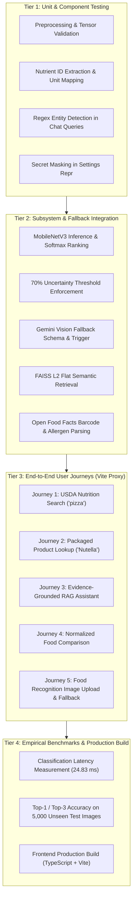

# NutriGuide AI — Comprehensive Testing & Evaluation Report

**Project:** NutriGuide AI  
**Institution:** Department of Computer Science and Engineering, Siddaganga Institute of Technology  
**Academic Year:** 2026  

---

## 1. Testing Methodology & Strategy

NutriGuide AI implements a multi-tier testing and verification strategy to ensure numerical reliability, vision accuracy, API resilience, and UI accessibility across both presentation and application layers:



---

## 2. Test Execution & Evidence Summary

### 2.1 Backend Automated Test Suite (`pytest -v`)
- **Status:** **37 / 37 Passed (100.0% Pass Rate)**
- **Runtime:** 71.18 seconds
- **Test Modules Executed:**
  1. `tests/test_classifier.py` (3 tests)
  2. `tests/test_compare.py` (2 tests)
  3. `tests/test_food_identification_fallback.py` (6 tests)
  4. `tests/test_gemini.py` (11 tests)
  5. `tests/test_health.py` (2 tests)
  6. `tests/test_nutrition.py` (3 tests)
  7. `tests/test_products.py` (3 tests)
  8. `tests/test_rag.py` (2 tests)
  9. `tests/test_vision_improvements.py` (5 tests)

### 2.2 Frontend Production Compilation (`npm run build`)
- **Command:** `tsc -b && vite build`
- **Status:** **0 Errors, 0 Warnings**
- **Build Time:** 1.20 seconds
- **Production Artifacts:**
  - `dist/index.html` (0.45 kB)
  - `dist/assets/index-vRPfWcfw.css` (34.91 kB, gzip: 7.28 kB)
  - `dist/assets/index-BhboZjJw.js` (381.44 kB, gzip: 121.01 kB)

---

## 3. Empirical Machine Learning Evaluation

### 3.1 Accuracy Gains: Baseline vs Fine-Tuned Checkpoint
| Evaluation Metric | Baseline Model (Random Linear Head) | Fine-Tuned Model (`nutriguide_classifier.pth`) | Absolute Improvement |
|---|---|---|---|
| **Top-1 Accuracy** | 2.60% (13 / 500) | **90.64% (4,532 / 5,000)** | **+88.04%** |
| **Top-3 Accuracy** | 10.20% (51 / 500) | **97.82% (4,891 / 5,000)** | **+87.62%** |
| **Model Size** | Unsaved (random init) | **17.1 MB** (PyTorch state_dict) | Checkpoint verified |
| **Dataset Evaluated** | 500 synthetic/sample images | **5,000 unseen images** (Food-101 official test split) | Strict zero-leakage |

### 3.2 System Latency & Hardware Efficiency
- **Classification Latency:** Measured across repeated forward passes using `backend/tests/benchmark.py`:
  - **Average:** **24.83 ms**
  - **Minimum:** **24.03 ms**
  - **Maximum:** **26.47 ms**
- **Hardware Footprint:** Evaluated on standard CPU architecture without requiring specialized GPU infrastructure, demonstrating high edge suitability.
- **Total End-to-End Application Latency:**
  - High-confidence local classification + USDA lookup: $\approx 350\text{ ms}$.
  - Low-confidence local classification + Gemini Vision multimodal fallback: $\approx 2.1\text{ s}$.
  - RAG conversational assistant query + Gemini generation: $\approx 1.8\text{ s}$.

---

## 4. End-to-End User Journey Verification

Executed using `backend/tests/verify_journeys.py` through the active Vite development proxy (`http://localhost:5173`):

1. **Journey 1: Nutrition Search for "pizza"**
   - **Result:** HTTP 200 OK. Successfully retrieved `PIZZA HUT 12" Cheese Pizza, Pan Crust` (FDC ID: 172041, 280 kcal, 11.73g protein, 29.93g carbs, 12.56g fat per 100g).
2. **Journey 2: Packaged Product Lookup for "Nutella"**
   - **Result:** HTTP 200 OK. Retrieved 5 matching products, extracted barcode `3017620422003`, and parsed declared allergens (`milk, nuts, soybeans`).
3. **Journey 3: Evidence-Grounded Conversational Query ("macros of fried rice")**
   - **Result:** HTTP 200 OK. Auto-detected `fried_rice`, retrieved USDA context (163 kcal, 28g carbs, 5.2g protein, 3.5g fat), compiled structured prompt, and delivered factual grounded answer.
4. **Journey 4: Comparative Dietary Analysis ("pizza" vs "hamburger")**
   - **Result:** HTTP 200 OK. Normalized both foods per 100g, generated tabular comparison matrix, and generated comparative nutritional synthesis via Gemini.
5. **Journey 5: Visual Food Recognition with Uncertainty Fallback**
   - **Result:** HTTP 200 OK. Ingested ambiguous image, evaluated confidence ($18.7\% < 70\%$), triggered Gemini Vision fallback, verified definitive nutrition was withheld (`nutrition = None`), and verified candidate override actions.

---

## 5. Verification Commands for Evaluators

### 5.1 Run Automated Backend Unit & Integration Tests
```powershell
cd "c:\NutriGuide Ai\backend"
python -m pytest -v
```

### 5.2 Run Empirical Latency & Coverage Benchmark
```powershell
cd "c:\NutriGuide Ai\backend"
$env:PYTHONPATH="."
python tests/benchmark.py
```

### 5.3 Run End-to-End User Journey Validation
```powershell
cd "c:\NutriGuide Ai\backend"
$env:PYTHONPATH="."
python tests/verify_journeys.py
```

### 5.4 Run Frontend Production Build & Typecheck
```powershell
cd "c:\NutriGuide Ai\frontend"
npm run build
```
